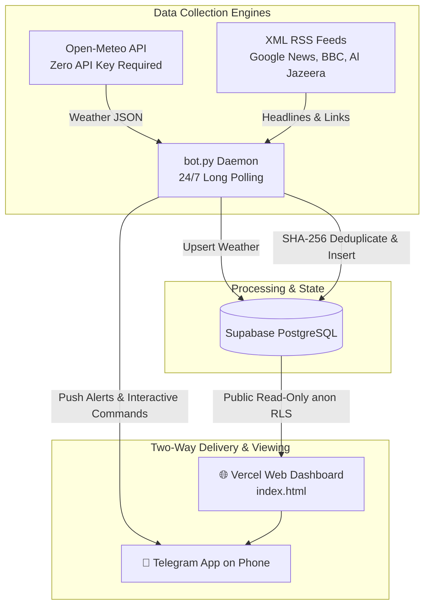

# 🛰️ 24/7 Autonomous News & Weather Bot + Live Vercel Dashboard

A complete, resilient pipeline that gathers **local and global weather** and **local and global news**, deduplicates items, pushes real-time mobile notifications via **Telegram Long Polling**, and displays everything on a stunning cyber-telemetry **Vercel web dashboard**.

---

## 🏛️ System Architecture



- **Weather Engine**: Queries Open-Meteo for exact coordinates (Local: Kitengela, Nairobi; Global: London, New York, Tokyo) without API keys.
- **News Engine**: Ingests structured XML RSS feeds from Google News Kenya, BBC World, and Al Jazeera, hashing titles and links with SHA-256 to prevent duplicate alerts.
- **Telegram Bot**: Long-polls for interactive commands (`/weather`, `/local`, `/global`, `/sync`, `/status`) and pushes instant notifications to your phone.
- **Vercel Web Dashboard**: Sleek, glassmorphic dark-mode dashboard displaying live meteorological cards, real-time news dispatches, search filtering, and auto-refresh.

---

## 📁 Repository Structure

```
MYBOT/
├── bot.py                    # 24/7 News & Weather telemetry bot daemon
├── core_bot.py               # General custom web collector bot (any CSS selector)
├── test_weather_news.py      # Instant test script for Open-Meteo & RSS feeds
├── test_local.py             # Instant test script for custom CSS scraper
├── schema.sql                # Supabase PostgreSQL schema with RLS policies
├── .env.example              # Environment variables template
├── vercel.json               # Vercel deployment configuration
├── index.html                # Telemetry Web Dashboard
├── style.css                 # Cyber-telemetry CSS design system
├── app.js                    # Frontend data engine, filtering & settings modal
└── requirements.txt          # Python dependencies (httpx, beautifulsoup4, python-dotenv)
```

---

## ⚡ Quick Setup & Launch

### 1. Database Setup (Supabase)
1. Go to [Supabase](https://supabase.com) and create or open your project.
2. In the left sidebar, click **SQL Editor** -> **New Query**.
3. Copy the contents of [`schema.sql`](schema.sql) and click **Run**.
4. Go to **Project Settings** -> **API**:
   - **Project URL** -> `SUPABASE_URL`
   - **service_role secret key** -> `SUPABASE_KEY` (Used strictly by Python bot)
   - **anon public key** -> `SUPABASE_ANON_KEY` (Used by Vercel web dashboard)

---

### 2. Telegram Bot Setup
1. Open Telegram and search for [@BotFather](https://t.me/BotFather).
2. Send `/newbot`, follow the prompts, and copy your **HTTP API Token**.
3. Message [@userinfobot](https://t.me/userinfobot) to get your numeric **Chat ID**.
4. Send `/start` to your newly created bot to initialize it.

---

### 3. Local Environment Configuration
Copy `.env.example` to `.env`:
```bash
cp .env.example .env
```
Update `.env` with your credentials:
```env
TELEGRAM_TOKEN=123456789:ABCdefGHIjklMNOpqrSTUvwxYZ
TELEGRAM_CHAT_ID=123456789
SUPABASE_URL=https://your-project.supabase.co
SUPABASE_KEY=your_supabase_service_role_secret
SUPABASE_ANON_KEY=your_supabase_anon_public_key
SYNC_INTERVAL=900
```

---

### 4. Test Feeds Offline
Verify that your system can fetch weather and news feeds directly:
```powershell
.\.venv\Scripts\python test_weather_news.py
```

---

### 5. Launch the 24/7 Bot
Start the background daemon:
```powershell
.\.venv\Scripts\python bot.py
```
Your phone will receive an initialization ping from your bot!
You can interact with it at any time using:
- `/weather` — Instant weather conditions across all cities
- `/local` — Top 5 latest local news headlines
- `/global` — Top 5 latest global news headlines
- `/sync` — Force an immediate scrape & notification cycle
- `/status` — View uptime and telemetry status

---

## 🌐 Deploy Web Dashboard to Vercel

### Option A: Via GitHub (Recommended)
1. Push this repository to GitHub:
   ```bash
   git add .
   git commit -m "Deploy News & Weather Bot and Dashboard"
   git branch -M main
   git remote add origin https://github.com/YOUR_USERNAME/YOUR_REPO.git
   git push -u origin main
   ```
2. Log in to [Vercel](https://vercel.com) and click **Add New...** -> **Project**.
3. Select your repository and click **Deploy**.
4. Vercel automatically detects `index.html` and [`vercel.json`](vercel.json) and gives you a free live URL (e.g. `https://mybot.vercel.app`)!

### Option B: Deploy via Vercel CLI
```powershell
npx -y vercel
```
Follow the interactive prompts to link and deploy in seconds.

### Connecting the Dashboard to Supabase:
Once your Vercel site is live:
1. Open your Vercel site in any browser.
2. Click the **Settings (⚙️)** button in the top navigation bar.
3. Enter your **Supabase URL** and **Anon Public Key**.
4. Click **Save & Connect**. Your credentials will be saved locally in your browser, connecting your live dashboard directly to your Supabase tables!
