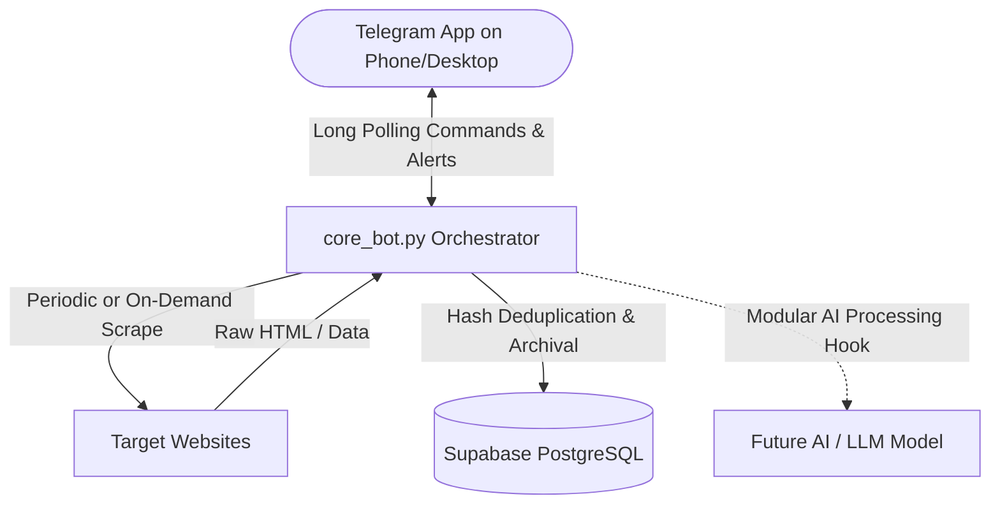

# 24/7 Web Collector Bot (No VPS, No Domain Required)

A resilient, continuous web scraping, deduplication, and notification bot built in Python. It features long polling via Telegram (allowing two-way command & control without any public domain or open ports), deduplication and storage in Supabase PostgreSQL, and modular hooks prepared for future AI model integration.

---

## 🏗️ Architecture Overview



1. **Extraction**: `httpx` and `BeautifulSoup4` extract elements using CSS selectors.
2. **Deduplication**: Content is normalized and hashed with SHA-256. Only **new or modified** records trigger alerts and store data in Supabase.
3. **Control & Delivery**: Telegram Long Polling (`getUpdates`) allows running on local PCs, Termux (Android), or scheduled cloud runners without a VPS or domain.
4. **AI-Ready Hook**: Contains a dedicated `process_extracted_data()` function ready for Gemini, Groq, or Claude integration.

---

## 📁 Project Structure

```
MYBOT/
├── .env.example              # Template for API keys and configuration
├── .gitignore                # Excludes .env, .venv, and logs from git
├── requirements.txt          # Python dependencies
├── schema.sql                # Supabase database schema for targets & records
├── core_bot.py               # Main 24/7 async bot engine & Telegram controller
├── test_local.py             # Offline test script to verify scraping on any URL
└── .github/
    └── workflows/
        └── bot_cron.yml      # (Optional) GitHub Actions workflow for zero-cost cloud runs
```

---

## 🚀 Quick Setup Guide

### 1. Database Setup (Supabase)
1. Create a free account at [Supabase](https://supabase.com).
2. Create a new project.
3. In the left menu, open **SQL Editor** -> **New Query**.
4. Copy and paste the contents of [`schema.sql`](schema.sql) and click **Run**.
5. Go to **Project Settings** -> **API**:
   - Copy **Project URL** -> `SUPABASE_URL`
   - Copy **service_role secret key** (revealed under Project API Keys) -> `SUPABASE_KEY`

---

### 2. Telegram Bot Setup
1. Open Telegram and search for [@BotFather](https://t.me/BotFather).
2. Send `/newbot`, choose a name and username, and copy the **HTTP API Token** -> `TELEGRAM_TOKEN`.
3. Search for [@userinfobot](https://t.me/userinfobot) on Telegram, click Start, and copy your numeric `Id` -> `TELEGRAM_CHAT_ID`.
4. Send a message like `/start` directly to your new bot to initialize the conversation.

---

### 3. Configure Local `.env`
Copy `.env.example` to `.env`:
```bash
cp .env.example .env
```
Open `.env` and fill in your values:
```env
TELEGRAM_TOKEN=123456789:ABCdefGHIjklMNOpqrSTUvwxYZ
TELEGRAM_CHAT_ID=123456789
SUPABASE_URL=https://your-project.supabase.co
SUPABASE_KEY=eyJhbGciOiJIUzI1NiIsInR5cCI6IkpXVCJ9...
SCRAPE_INTERVAL=300
```

---

### 4. Test Extraction Offline First
Before running the 24/7 daemon, test that scraping and deduplication work on your machine:
```bash
.\.venv\Scripts\python test_local.py https://news.ycombinator.com .titleline
```

---

### 5. Run the 24/7 Collector Bot
Start the daemon locally:
```bash
.\.venv\Scripts\python core_bot.py
```
Once initialized, your Telegram bot will message you:
> `🚀 Core Bot daemon initialized. Send /help for commands.`

---

## 📱 Telegram Bot Commands

| Command | Usage | Description |
| :--- | :--- | :--- |
| `/help` | `/help` | View all available bot commands |
| `/add` | `/add <url> [css_selector]` | Add a new target to monitor (default selector is `title`) |
| `/list` | `/list` | List all active monitoring targets |
| `/remove` | `/remove <id>` | Delete a target by ID |
| `/run` | `/run` | Trigger an immediate scrape cycle across all targets |
| `/status` | `/status` | View uptime, active targets count, and intervals |

### Example Command Sequence in Telegram:
1. `/add https://news.ycombinator.com .titleline`
2. `/run` (instantly receives the top stories)
3. `/run` again (nothing sent because the SHA-256 hash hasn't changed!)

---

## ☁️ 24/7 Hosting Options (Without a VPS)

1. **Local PC / Laptop**: Run `python core_bot.py` in the background (or as a Windows Service / PM2).
2. **Android via Termux**: Install Python and run via `tmux` or `nohup` on an old phone connected to Wi-Fi.
3. **GitHub Actions (Cloud)**:
   - Push this repo to GitHub.
   - Go to **Settings** -> **Secrets and variables** -> **Actions**.
   - Add `TELEGRAM_TOKEN`, `TELEGRAM_CHAT_ID`, `SUPABASE_URL`, and `SUPABASE_KEY`.
   - The workflow [`.github/workflows/bot_cron.yml`](.github/workflows/bot_cron.yml) will run every 15 minutes automatically.
